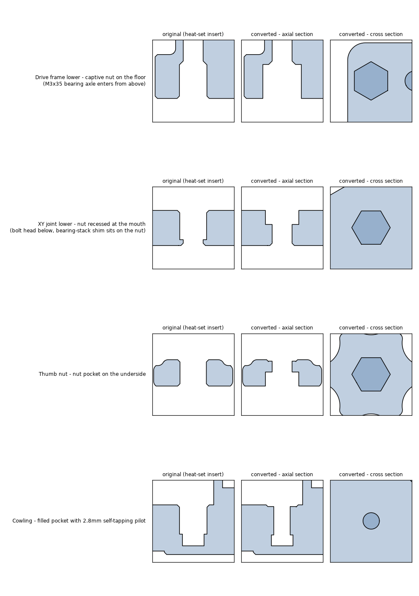

# Voron 0.2r1 - No Heat-Set Inserts

This branch of the V0.2r1 printed parts has **no heat-set inserts**. Every
insert pocket in the STLs has been replaced by one of two features:

| Replacement | Where | How it works |
|---|---|---|
| **Captive M3 hex nut** | Joints where the screw arrives from the far side of the pocket: the drive-frame and XY-joint bearing axles, and the bed thumb nuts | The round pocket becomes a 5.7 mm across-flats hex. A standard M3 nut drops in and the screw pulls it against printed material, exactly the load path the insert had. |
| **Self-tapping pilot** | Everywhere else | The pocket is filled solid and a 2.8 mm pilot hole is left. The M3 screw the manual already calls for forms its own thread in the plastic. |

Screw lengths are unchanged, and no new screw types are needed.



## Hardware changes

For a standard build (direct-drive Mini Stealthburner, one hotend):

| | Stock V0.2r1 | This variant |
|---|---|---|
| M3 heat-set inserts | 43 | **0** |
| Extra M3 hex nuts (DIN 934 / ISO 4032) | – | **+11** |

The 11 nuts are: 2 per drive frame lower (4), 2 per XY joint lower (4), and
1 per thumb nut (3). The other 32 former insert positions are self-tapped by
the M3 BHCS the manual already lists.

## Changed parts

Page numbers refer to the V0.2r1 assembly manual.

### Captive nut

| Part | Pockets | Notes | Manual |
|---|---|---|---|
| `A_Drive_Frame_Lower_x1`, `B_Drive_Frame_Lower_x1` | 2 of 3 (outer) | Hex over the full pocket depth from the bottom face. The nut sits on the original floor, where the insert used to bottom out. The M3x35 axle screws come in from above, as before. | 69-70, 75-76 |
| `XY_Joint_Left_Lower_x1`, `XY_Joint_Right_Lower_x1` | 2 | Hex recess exactly one nut deep (2.4 mm) in the top face, with 3.5 mm of solid plastic and a 3.4 mm clearance hole below. The M3x25 head is underneath. The nut ends **flush**, so the first M3 shim of the bearing stack rests on the nut and the stack height is unchanged. | 115, 117 |
| `[a]_Thumb_Nut_x3` | 1 | 2.4 mm deep hex in one face, 3.4 mm clearance through the rest. | 145 |

### Self-tapping pilot (2.8 mm)

Thread length = the length of filled plastic the screw cuts into.

| Part | Pockets | Thread length |  Manual |
|---|---|---|---|
| `A/B_Drive_Frame_Lower_x1` | 1 (centre, blind) | 5.0 mm | 69, 75 |
| `A/B_Drive_Frame_Upper_x1` | 1 (side, tophat cam lock) | 3.4 mm | 70, 76 |
| `Electronics/Fan_Mount_Bottom_x1` | 4 | 6.2 mm | 193, 200 |
| `Rear_Bed_Mount_Right_x1` | 2 (drag chain) | 9.2 mm | 37 |
| `Skirts/Foot_Front_Left_x1`, `Foot_Front_Right_x1` | 1 | 5.2 mm | 101 |
| `Skirts/Foot_Rear_Left_Inlet_x1` | 2 | 5.4 / 5.8 mm | 102 |
| `Skirts/Foot_Rear_Right_FRS_x1` | 2 | 3.8 / 5.6 mm | 102 |
| `Skirts/Foot_Rear_Right_Plain` | 2 | 5.2 / 5.6 mm | 102 |
| `Toolheads/Mini_Stealthburner/[a]_MiniSB_MidBody_x1` | 4 | 4.8-5.8 mm | 157-158, 163 |
| `Toolheads/Mini_Stealthburner/[a]_MiniSB_Cowling_x1` | 3 | 4.2-4.8 mm | 157-158 |
| `Toolheads/Mini_Stealthburner/[a]_Shuttle_x1` | 1 | 4.6 mm | 157, 168 |
| `Toolheads/Mini_Stealthburner/Strain_Relief_Spacer_x2` | 2 (both ends) | 5.0 mm | 157, 186 |
| `X_Carriage_x1` | 4 | 3.8 mm (front), 4.6 mm (top) | 133 |
| `Toolheads/Bowden/MiniSB_Bowden_*` (option) | 1 | 5.0 mm | – |
| `Toolheads/Hotend_Mounts/*/[a]_*Hotend_Mount_Bambu_X1C` (option) | 2 | 5.0 mm | 180 |
| `Toolheads/Hotend_Mounts/Standard/[a]_Hotend_Mount_MicroSwiss_All_Metal` (option) | 2 | 4.0 mm | 180 |
| `Multibody_STLs/Cowling/[a]_MiniSB_Cowling_Multibody` | 3 | rebuilt from the converted cowling: cowling body + logo body | – |

All other STLs are unchanged. They either never had inserts, or their round
pockets are counterbores for M2/M2.5 screw heads or PTFE bores; the Dragon,
Dragonfly, Formbot, Creality, Revo, Drop Effect and TZ-E3 hotend mounts are
examples.

## Assembly notes

Follow the stock manual. Wherever it says *Heat Set Insert*:

**Captive-nut parts**

- **Drive frame lower** (p. 69/75): drop an M3 nut into each of the two outer
  hex pockets on the bottom face and push it to the bottom. A small piece of
  tape keeps it in place while the drive is assembled upside down. The centre
  pocket is now a pilot hole.
- **XY joint lower** (p. 115/117): press an M3 nut into each hex recess in the
  top face. It should sit flush with the face. If your nuts are noticeably
  thinner than 2.4 mm and end below the face, put one extra M3 shim on top
  before the bearing stack, so the stack height stays the same.
- **Thumb nuts** (p. 145): press an M3 nut into the hex. Install the thumb nut
  with the **hex facing down**, away from the bed mount. The screw then pulls
  the nut against the printed face rather than out of its pocket.

**Self-tapping holes**

- Drive the M3 screw in slowly by hand the first time; it is cutting its own
  thread. Back it out, clean off any chips, and drive it in again.
- Stop once the head seats. Plastic threads strip easily if over-tightened.
  This matters most on the cowling, shuttle, hinge-pin and X carriage
  screws, which get removed during maintenance.
- **Strain relief spacers**: form the thread in both ends with a spare M3
  screw before installation. Then the spacer can be spun onto the protruding
  M3x10 by hand. The manual's suggestion of metal M3x20 female-female
  standoffs still applies and is the sturdier choice.
- **Shuttle** (extruder tension screw): the spring keeps this screw under
  constant light tension. The thread is formed in solid plastic, but avoid
  winding the tension screw in and out more than necessary.
- The tophat cam lock pivot screw (drive frame upper side hole) has only
  3.4 mm of thread. Use a drop of medium threadlocker, as the manual already
  recommends for the cam lock.

## Printing

Print with the standard Voron settings: 4 perimeters (walls), 5 top and bottom
layers, 40% infill. With 4 × 0.4 mm walls, every pilot hole is surrounded by
solid perimeters, so infill percentage does not affect thread strength.

If your printer makes small holes noticeably undersized and the screws are
very hard to drive, open the pilot holes with a 2.8 mm drill. Do not go
larger than 2.9 mm.

The nut pockets are sized at 5.7 mm across flats, which is a press fit or
easy fit for M3 nuts on most printers.

## Design notes and limitations

- **Why not nuts everywhere?** A captive nut only carries load if the screw
  pulls it *into* printed material. That is true where the screw enters
  through the pocket floor: the drive and XY-joint axle bolts, and the thumb
  nuts. Where the screw enters through the pocket mouth, a nut in the old
  pocket would be pulled straight out. Those positions need a side-loaded nut
  slot, which these compact parts have no room for, so they use thread-forming
  holes instead.
- **Bambu X1C and MicroSwiss hotend mounts** are also floor-entry joints, but
  a hex does not fit. The Bambu pockets are 6.85 mm apart and 3.35 mm from the
  top face. The MicroSwiss pockets sit in a 3.4 mm radius boss. They use
  pilots; the screw passes the existing clearance hole first and then cuts its
  thread.
- Every nut pocket was checked for at least 0.8 mm of wall around the hex,
  except where the pocket already had a neighbouring hole. On the drive
  frames, the hex flats face the outer wall.
- Only the **STLs** are modified. The Fusion 360 master (`CAD/*.f3d`), the
  STEP files, and the assembly manual still show heat-set inserts.

## Regenerating

The STLs were produced from the unmodified `Voron0.2r1` branch by the scripts
in [`scripts/`](scripts). They read the original parts straight from git, so
re-running them always starts from upstream geometry.

```sh
pip install trimesh manifold3d shapely scipy numpy matplotlib
cd Mods/No_Heat_Set_Inserts/scripts
python catalog.py            # find insert-sized pockets in the upstream STLs -> catalog.json (slow)
python apply.py              # convert the parts listed in apply.py SPEC, in place
python multibody_cowling.py  # rebuild the multibody cowling from the converted cowling
python verify.py             # profile every converted pocket, check watertightness
python cutaway.py            # regenerate cutaways.png
```

`apply.py` holds the per-pocket decisions (nut or pilot, which end is the
mouth, hex orientation), with the reasoning in comments.
